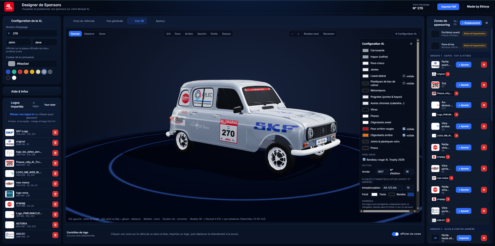

# 🚙 4L Trophy – Designer de Sponsors

Un projet né d'une idée : créer un outil simple et intuitif pour imaginer la décoration de sa 4L Trophy, visualiser ses sponsors et concevoir un habillage personnalisé avant le grand départ !

À partir de cette idée et de mes envies, j'ai utilisé **Claude (Anthropic)** pour concevoir et développer cette application, en faisant évoluer le résultat au fil de mes indications.

## 🌐 Accéder à l'application

👉 **[Ouvrir le Designer de Sponsors](https://ekktorp.github.io/4L-Trophy-designer/)**

L'application est accessible directement depuis un navigateur, sans installation.

## ✨ Fonctionnalités

- 🎨 Personnalisation visuelle de la 4L
- 🏷️ Ajout et placement de logos de sponsors
- 🖌️ Personnalisation de la décoration et des couleurs
- 👥 Gestion des éléments de l'équipage
- 💾 Sauvegarde des personnalisations dans le navigateur
- 📦 Import et export des projets

## 🚀 Utilisation

1. Ouvrir l'application avec le lien ci-dessus.
2. Personnaliser sa 4L et ajouter ses sponsors.
3. Ajuster les éléments visuels selon ses envies.
4. Enregistrer ou exporter son projet pour le retrouver plus tard.

## 🔒 Données et confidentialité

Les personnalisations sont enregistrées localement dans le navigateur. Aucun compte utilisateur n'est nécessaire.

Attention : les projets exportés peuvent contenir les informations et logos ajoutés par l'utilisateur. Pensez à les conserver en lieu sûr.

## 🛠️ Technologies

Application web basée sur HTML, CSS et JavaScript, avec plusieurs bibliothèques externes pour les fonctionnalités graphiques.

- **Idée et direction du projet :** conception personnelle
- **Développement :** réalisé avec l'aide de Claude (Anthropic)
- **Hébergement :** GitHub Pages

---

*Une idée personnelle devenue un petit outil concret pour préparer l'aventure 4L Trophy !* 🚙
